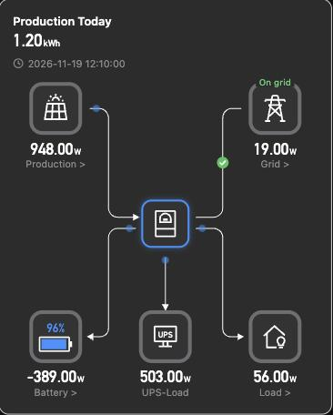

# Deye Cloud Power Flow Card

A Home Assistant Lovelace card that shows the power flow of a Deye hybrid inverter the way the **Deye Cloud** app does: six nodes around the inverter, orthogonal lines with animated flow dots, and detail panels.



> **Unofficial.** This project is not affiliated with, endorsed by or connected to Deye.

## Features

- Production, Grid, Inverter, Battery, UPS-Load and Load nodes, laid out like the app.
- Flow direction from the sign of each power; idle lines show no arrow and no dot.
- On grid / Off grid with a check or cross on the grid line; SOC inside the battery node, coloured by thresholds.
- Tap Production, Grid, Inverter, Battery or Load for a detail panel; tap a row to open the entity's history (more-info).
- Missing or unavailable entities show "—"; the update time turns orange when data is stale.
- `theme: deye` for the app's dark palette, or follow your Home Assistant theme. Works in masonry and sections dashboards.

## Installation (HACS custom repository)

1. HACS → ⋮ → **Custom repositories** → add `https://github.com/nsmaster/deye-cloud-power-flow-card`, type **Dashboard**.
2. Find **Deye Cloud Power Flow Card** → **Download**. HACS adds the dashboard resource.
3. Reload the browser and add the card.

## Configuration

### Solarman Stick Logger (ha-solarman)

With [davidrapan/ha-solarman](https://github.com/davidrapan/ha-solarman) and the `deye_hybrid` profile, the preset fills in every entity. `prefix` is the device name in Home Assistant (`inverter` by default).

```yaml
type: custom:deye-cloud-power-flow-card
preset: solarman
prefix: inverter
theme: deye
```

The preset uses the external CT (`sensor.<prefix>_external_power`) as grid power. Without an external CT, point it at the inverter's grid port instead:

```yaml
grid:
  power: sensor.inverter_grid_power
  inner_power: null   # null removes a preset entity
```

### Any other source (ESPHome, MQTT, …)

Set the entities yourself. Only `unit_of_measurement` and the value matter; W/kW and Wh/kWh/MWh are converted automatically.

```yaml
type: custom:deye-cloud-power-flow-card
pv:
  power: sensor.deye_pv_power          # or computed: pv1_power + pv2_power
  energy_today: sensor.deye_pv_energy_today
grid:
  power: sensor.deye_grid_power        # + import / − export
  status: binary_sensor.deye_grid_connected
battery:
  power: sensor.deye_battery_power     # + discharge / − charge, or computed: voltage × current
  soc: sensor.deye_battery_soc
  invert: false                        # flip the sign if your source differs
ups:
  power: sensor.deye_ups_load_power
load:
  power: sensor.deye_grid_side_load    # optional, otherwise grid.power − grid.inner_power
```

Explicit keys always override the preset.

Nothing is required. A node with no configured or computable value is not drawn; a configured but unavailable entity shows "—". Computed when there is no entity:

- `pv.power` = `pv1_power` + `pv2_power`, and each string's power = its voltage × current;
- `battery.power` = `battery.voltage` × `battery.current`;
- `load.power` = `grid.power` − `grid.inner_power`.

### Detail panels

Rows appear only when their entity is configured (or can be computed).

| Panel | Rows (entity key) |
| --- | --- |
| Production | DC Power / Voltage / Current PV1, PV2 (`pv.pv1_*`, `pv.pv2_*`), Grid Tie Power (`inverter.power`) |
| Grid | Grid Status (`grid.status` or voltage), Frequency, Total Grid Power, Voltage L1, Daily / Cumulative Import and Export |
| Inverter | Inverter Voltage L1, Output Power L1, Frequency (`inverter.*`) |
| Battery | Battery Status (`battery.status` or computed), Power, Voltage, Current, Temperature |
| Load | Total Load Power (grid-side load), Load Power L1 (UPS + grid-side), Load Voltage L1 (`ups.voltage`), Daily / Cumulative Load |

UPS-Load has no panel, as in the app.

### Options

| Option | Default | Description |
| --- | --- | --- |
| `title` | — | Station name in the header |
| `theme` | `ha` | `ha` follows the HA theme, `deye` forces the Deye Cloud dark palette |
| `preset` / `prefix` | `none` / `inverter` | Entity preset and device name |
| `min_flow_w` | `50` | Lines at or below this power stay idle (no arrow, no dot) |
| `stale_after_s` | `300` | Header time turns orange when data is older than this |
| `show_sign` | `true` | Show the sign of power, as the app does (`-389.00 W`) |
| `grid.no_grid_voltage` | `100` | Off grid below this voltage when `grid.status` is not set |
| `battery.soc_warning` / `battery.soc_critical` | `50` / `20` | SOC colour thresholds |
| `<node>.name` | — | Custom label (`pv`, `grid`, `battery`, `ups`, `load`) |
| `<node>.icon` | — | mdi icon instead of the built-in one, e.g. `mdi:solar-power` |
| `<node>.hidden` | `false` | Hide a node and its line |
| `<node>.invert` | `false` | Flip the sign of the node's power |
| `demo` | — | Built-in sample data instead of entities: `day_charge`, `night_discharge`, `export`, `off_grid`, `low_battery`, `offline` |

### Entities

Every key takes an entity id. The last column is what `preset: solarman` fills in (`<prefix>` = `inverter` by default).

| Key | Meaning | Shown in | `preset: solarman` |
| --- | --- | --- | --- |
| `pv.power` | Total PV power, W (computed from `pv1_power` + `pv2_power` if unset) | Production node | `sensor.<prefix>_pv_power` |
| `pv.pv1_power`, `pv.pv2_power` | String power, W (computed from voltage × current if unset) | Production panel | `sensor.<prefix>_pv1_power`, `_pv2_power` |
| `pv.pv1_voltage`, `pv.pv2_voltage` | String voltage, V | Production panel | `sensor.<prefix>_pv1_voltage`, `_pv2_voltage` |
| `pv.pv1_current`, `pv.pv2_current` | String current, A | Production panel | `sensor.<prefix>_pv1_current`, `_pv2_current` |
| `pv.energy_today` | PV energy today, kWh | Header: Production Today | `sensor.<prefix>_today_production` |
| `pv.energy_total` | PV energy total | not shown yet | `sensor.<prefix>_total_production` |
| `grid.power` | Grid power at the CT, W, + import / − export | Grid node | `sensor.<prefix>_external_power` |
| `grid.inner_power` | Inverter grid port power, W, + import | Load calculation | `sensor.<prefix>_grid_power` |
| `grid.status` | Grid connected (`binary_sensor` or `sensor`) | "On grid" / "Off grid", Grid panel | `binary_sensor.<prefix>_grid` |
| `grid.voltage` | Grid voltage, V (status fallback, see `no_grid_voltage`) | Grid panel | `sensor.<prefix>_grid_l1_voltage` |
| `grid.frequency` | Grid frequency, Hz | Grid panel | `sensor.<prefix>_grid_frequency` |
| `grid.import_today`, `grid.export_today` | Energy imported / exported today | Grid panel | `sensor.<prefix>_today_energy_import`, `_today_energy_export` |
| `grid.import_total`, `grid.export_total` | Energy imported / exported total | Grid panel | `sensor.<prefix>_total_energy_import`, `_total_energy_export` |
| `inverter.power` | Inverter AC output, W | Inverter panel, Production panel (Grid Tie Power) | `sensor.<prefix>_power` |
| `inverter.voltage` | Inverter output voltage, V | Inverter panel | `sensor.<prefix>_output_l1_voltage` |
| `inverter.frequency` | Inverter output frequency, Hz | Inverter panel | `sensor.<prefix>_output_frequency` |
| `inverter.temperature`, `inverter.status` | Inverter temperature / state | not shown yet | `sensor.<prefix>_temperature`, `_device_state` |
| `battery.power` | Battery power, W, + discharge / − charge (computed from voltage × current if unset) | Battery node | `sensor.<prefix>_battery_power` |
| `battery.soc` | State of charge, % | Battery node | `sensor.<prefix>_battery` |
| `battery.voltage` | Battery voltage, V | Battery panel | `sensor.<prefix>_battery_voltage` |
| `battery.current` | Battery current, A, same sign as power | Battery panel | `sensor.<prefix>_battery_current` |
| `battery.temperature` | Battery temperature | Battery panel | `sensor.<prefix>_battery_temperature` |
| `battery.status` | Charging / idle / discharging (computed from power if unset) | Battery panel | `sensor.<prefix>_battery_state` |
| `battery.charge_today`, `battery.discharge_today` | Battery energy today | not shown yet | `sensor.<prefix>_today_battery_charge`, `_today_battery_discharge` |
| `ups.power` | UPS / Backup output, W (Deye "Load" port) | UPS-Load node | `sensor.<prefix>_load_power` |
| `ups.voltage` | UPS output voltage, V | Load panel (Load Voltage L1) | `sensor.<prefix>_load_l1_voltage` |
| `ups.energy_today` | UPS energy today | not shown yet | — |
| `load.power` | Grid-side load, W (computed from `grid.power` − `grid.inner_power` if unset) | Load node, Load panel | — |
| `load.total_power` | All loads, W (computed from UPS + grid-side load if unset) | Load panel (Load Power L1) | — |
| `load.energy_today`, `load.energy_total` | Load energy today / total | Load panel | `sensor.<prefix>_today_load_consumption`, `_total_load_consumption` |

### Full example

All options in one place; leave out whatever you don't need.

```yaml
type: custom:deye-cloud-power-flow-card
title: Home                # optional header line
theme: deye                # deye | ha (default)
preset: solarman           # solarman | none (default)
prefix: inverter           # ha-solarman device name
min_flow_w: 50
stale_after_s: 300
show_sign: true
# demo: day_charge

pv:
  power: sensor.inverter_pv_power
  pv1_power: sensor.inverter_pv1_power
  pv1_voltage: sensor.inverter_pv1_voltage
  pv1_current: sensor.inverter_pv1_current
  pv2_power: sensor.inverter_pv2_power
  pv2_voltage: sensor.inverter_pv2_voltage
  pv2_current: sensor.inverter_pv2_current
  energy_today: sensor.inverter_today_production
  energy_total: sensor.inverter_total_production
  name: Production
  icon: mdi:solar-power
  hidden: false
  invert: false

grid:
  power: sensor.inverter_external_power
  inner_power: sensor.inverter_grid_power
  status: binary_sensor.inverter_grid
  voltage: sensor.inverter_grid_l1_voltage
  frequency: sensor.inverter_grid_frequency
  import_today: sensor.inverter_today_energy_import
  export_today: sensor.inverter_today_energy_export
  import_total: sensor.inverter_total_energy_import
  export_total: sensor.inverter_total_energy_export
  no_grid_voltage: 100
  name: Grid
  icon: mdi:transmission-tower
  hidden: false
  invert: false

inverter:
  power: sensor.inverter_power
  voltage: sensor.inverter_output_l1_voltage
  frequency: sensor.inverter_output_frequency
  temperature: sensor.inverter_temperature
  status: sensor.inverter_device_state
  name: Inverter           # used for the panel title and screen readers
  icon: mdi:solar-power-variant
  invert: false            # the inverter cannot be hidden

battery:
  power: sensor.inverter_battery_power
  soc: sensor.inverter_battery
  voltage: sensor.inverter_battery_voltage
  current: sensor.inverter_battery_current
  temperature: sensor.inverter_battery_temperature
  status: sensor.inverter_battery_state
  charge_today: sensor.inverter_today_battery_charge
  discharge_today: sensor.inverter_today_battery_discharge
  soc_warning: 50
  soc_critical: 20
  name: Battery
  icon: mdi:battery-high   # with a custom icon the SOC and fill inside the node are not drawn
  hidden: false
  invert: false            # also flips battery.current

ups:
  power: sensor.inverter_load_power
  voltage: sensor.inverter_load_l1_voltage
  energy_today: sensor.ups_energy_today
  name: UPS-Load
  icon: mdi:power-plug-battery
  hidden: false
  invert: false

load:
  power: sensor.grid_side_load_power
  total_power: sensor.total_load_power
  energy_today: sensor.inverter_today_load_consumption
  energy_total: sensor.inverter_total_load_consumption
  name: Load
  icon: mdi:home-lightning-bolt
  hidden: false
  invert: false
```

## Development

```bash
npm install
npm run dev        # http://localhost:5173/dev/ — simulated entities and demo scenarios
npm test           # unit tests (Vitest)
npm run lint
npm run build      # dist/deye-cloud-power-flow-card.js
```

Releases: publishing a GitHub release `vX.Y.Z` builds the card and attaches `deye-cloud-power-flow-card.js` to it; HACS picks it up from there.

## License

MIT
